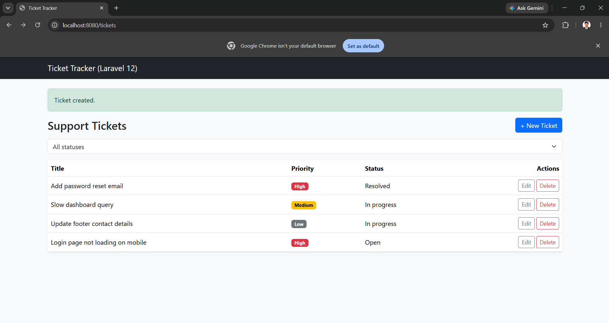
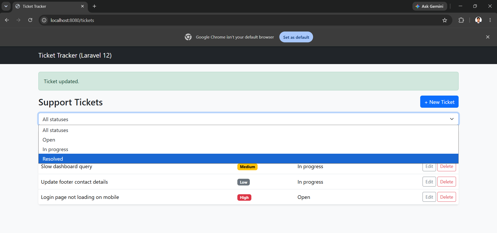
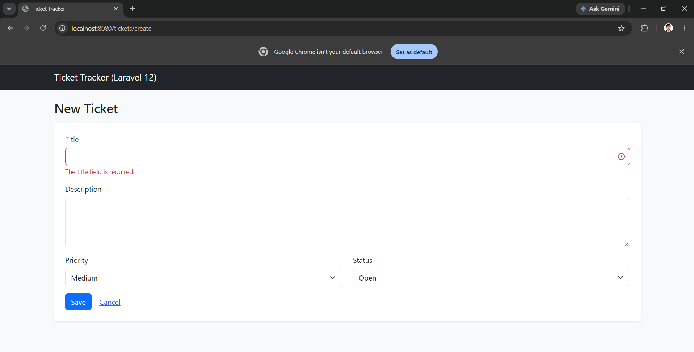
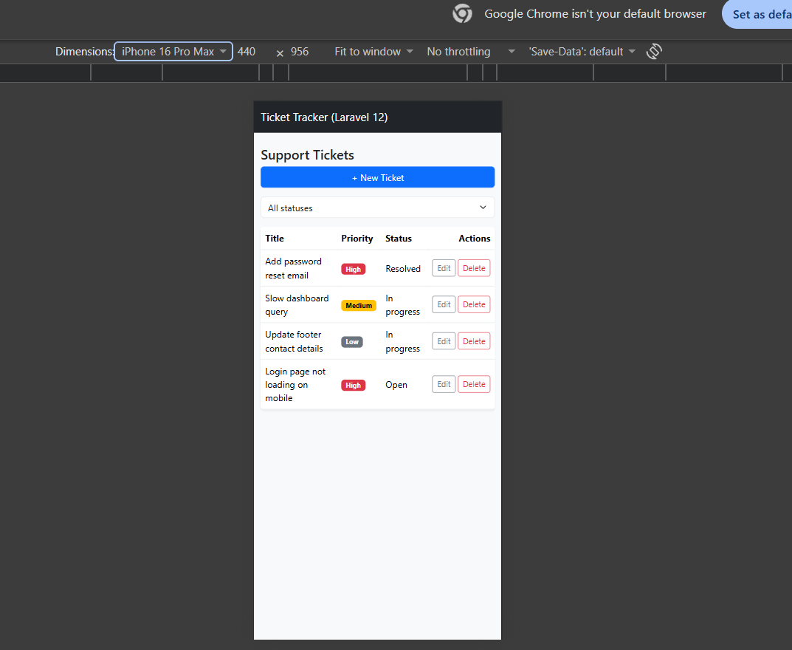

# Laravel Ticket Tracker

A support ticket tracker built with Laravel 12, Blade, Bootstrap 5 and MySQL.
It is deployed to an Ubuntu 24.04 environment (WSL2) with Nginx and PHP-FPM.

## Features
- Create, edit and delete tickets (CRUD) with server-side validation
- Filter by status and paginated list
- Responsive layout for desktop and mobile

## Screenshots

## Tech stack
PHP 8.3, Laravel 12, MySQL, Blade, Bootstrap 5, Nginx, PHP-FPM, Git

## Local setup
    composer install
    cp .env.example .env
    php artisan key:generate
    php artisan migrate
    php artisan serve

## Deployment
Deployed on Ubuntu 24.04 (WSL2) with Nginx, PHP-FPM 8.3 and MySQL:
- Production `.env` (APP_ENV=production, APP_DEBUG=false) and a dedicated MySQL user with limited privileges
- Nginx server block serving `public/` through a PHP-FPM socket
- Storage and cache permissions set for `www-data`
- `deploy.sh` for Git-based deploys: pull, composer install, migrate, optimize

Next steps on a real VPS: domain with Let's Encrypt SSL, SSH key login, fail2ban, backups.
